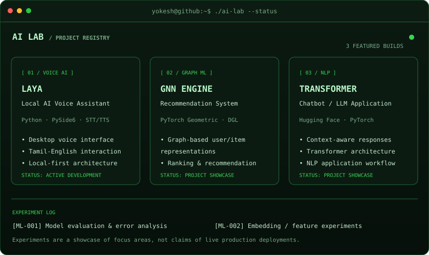

<h3>GitHub Activity</h3>

  
<h3>About</h3>
<table>
<tr>
<td valign="top"></td>
<td valign="top"></td>
</tr>
</table>
  
<h3>Connect</h3>
<b>ML Data Analyst · AI Builder · Data & ML Engineering</b>  

---

### About

I'm Yokesh, an ML Data Analyst interested in building practical AI systems, machine learning solutions, and reliable data workflows.

- **Focus:** Machine Learning, Deep Learning, Data Engineering, AI automation
- **Languages:** Python, SQL, JavaScript, Java
- **ML stack:** PyTorch, TensorFlow, scikit-learn, Hugging Face
- **Data & cloud:** Pandas, NumPy, Azure, AWS
- **Currently building:** Laya — a local desktop AI voice assistant

### AI Lab

**AI Lab / Featured builds**

- **Laya AI Assistant:** Local Python/PySide6 desktop voice assistant with speech recognition and text-to-speech.
- **GNN Recommendation System:** Graph-based recommendation project using PyTorch Geometric / DGL concepts.
- **Transformer Chatbot:** Transformer and LLM application work using PyTorch and Hugging Face.
- **ML Experiments:** Model evaluation, feature/embedding experiments, and error analysis.

### Projects

| Project | Description |
|---|---|
| Laya AI Voice Assistant | Local Python/PySide6 voice assistant |
| GNN Recommendation System | Graph-based recommendation prototype |
| Transformer Chatbot | Transformer/LLM application |
| Hazardous Material Detection | Computer-vision safety project |

Minimal monochrome ASCII portrait with a subtle typing reveal. AI Lab highlights Laya, GNN, Transformer and machine-learning experiments. Contribution graph and statistics are refreshed daily using GitHub Actions.
