<h3><code>yokesh@github ~ $ ./contributions.sh</code></h3>

  
<h3><code>yokesh@github ~ $ whoami</code></h3>
<table><tr>
<td valign="top"></td>
<td valign="top"></td>
</tr></table>
 
<h3><code>yokesh@github ~ $ ./links.sh</code></h3>
**ML Data Analyst · AI Builder · Data & ML Engineering**

---

### $ cat about.txt

I'm Yokesh, an ML Data Analyst interested in building practical AI systems, reliable data pipelines, and useful developer tools.

- **Focus:** Machine Learning, Deep Learning, Data Engineering, AI automation
- **Languages:** Python, SQL, JavaScript, Java
- **ML stack:** PyTorch, TensorFlow, scikit-learn, Hugging Face
- **Data & platform:** Pandas, NumPy, Azure, AWS, Docker, GitHub Actions
- **Currently building:** Laya, a local desktop AI voice assistant

### $ ls projects/

| Project | Description |
|---|---|
| Laya AI Voice Assistant | Local Python/PySide6 voice assistant |
| GNN Recommendation System | Graph-based recommendation prototype |
| Transformer Chatbot | Transformer/LLM application |
| Hazardous Material Detection | Computer-vision safety project |

Profile art generated with Python and animated SVG. Contribution calendar refreshed daily with GitHub Actions.
