<h3><code>yokesh@github ~ $ ./contributions.sh</code></h3>

  
<h3><code>yokesh@github ~ $ whoami</code></h3>
<table>
<tr>
<td valign="top"></td>
<td valign="top"></td>
</tr>
</table>
  
<h3><code>yokesh@github ~ $ ./links.sh</code></h3>
<b>ML Data Analyst · AI Builder · Data & ML Engineering</b>  

---

### `$ cat about.txt`

I'm Yokesh, an ML Data Analyst interested in building practical AI systems, machine learning solutions, and reliable data workflows.

- **Focus:** Machine Learning, Deep Learning, Data Engineering, AI automation
- **Languages:** Python, SQL, JavaScript, Java
- **ML stack:** PyTorch, TensorFlow, scikit-learn, Hugging Face
- **Data & cloud:** Pandas, NumPy, Azure, AWS
- **Currently building:** Laya — a local desktop AI voice assistant

### `$ ls projects/`

| Project | Description |
|---|---|
| Laya AI Voice Assistant | Local Python/PySide6 voice assistant |
| GNN Recommendation System | Graph-based recommendation prototype |
| Transformer Chatbot | Transformer/LLM application |
| Hazardous Material Detection | Computer-vision safety project |

Animated SVG profile art generated with Python. Contribution graph and statistics are refreshed daily using GitHub Actions.
